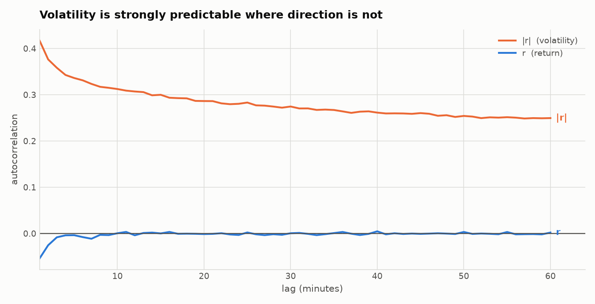
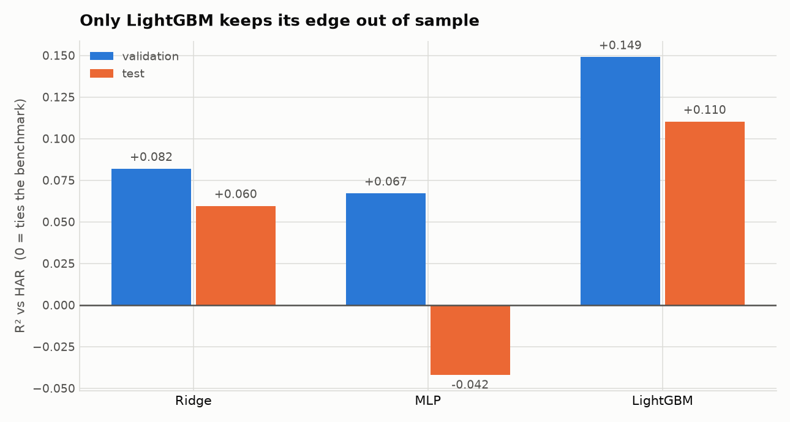
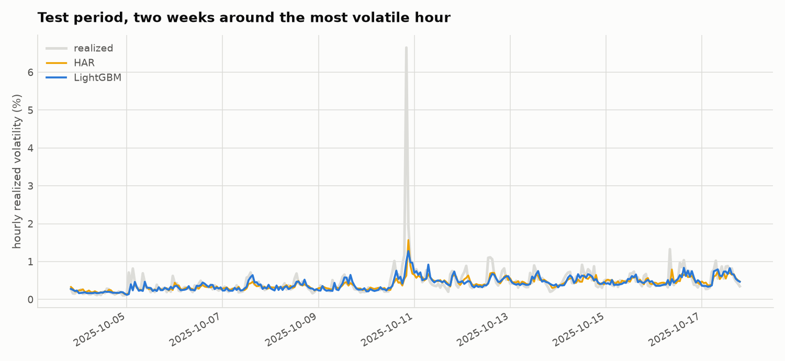

# ForeSight Phase 1 — results

**Can a machine-learning model forecast Bitcoin better than a standard econometric
benchmark?** For direction: no. For volatility: yes, by a margin that survives out of sample.

*Data: Binance BTCUSDT 1-minute, 2017-08-17 to 2026-07-31, 4,701,438 bars.
All numbers regenerate from committed scripts. Reproduce with the four commands in §7.*

---

## 1. The headline

| | verdict |
|---|---|
| **Next-bar return** | **Not predictable.** Momentum scores R² = −1.02 against a zero forecast, with a 49.4% hit rate — below a coin flip. |
| **Next-hour volatility** | **Predictable, and ML helps.** LightGBM beats the HAR benchmark by **+14.9% R² on validation and +11.0% on test**, significant at p < 1e-30. |

The project began aimed at returns. The data redirected it to volatility, and that redirection is
the single most valuable thing phase 1 produced.

---

## 2. Why the target changed

Reconnaissance on the training split alone, before any model was built:

| quantity | ACF lag 1 | ACF lag 60 |
|---|---|---|
| return `r` | −0.054 | ~0.000 |
| **absolute return `\|r\|`** | **+0.418** | **+0.250** |

Direction dies by lag 3. Volatility is still strongly autocorrelated an hour out. The lag-1 return
autocorrelation *is* statistically significant — but it is **negative**, i.e. mean reversion
consistent with bid–ask bounce, which lives inside the spread and does not survive costs.



---

## 3. Results

Primary target: `log RV` over the next hour, where `RV_t = sqrt(Σ r²)` over the hour's
1-minute log-returns.

### Validation — 13,127 hours, 2024-01-01 → 2025-06-30

| model | RMSE | MAE | QLIKE | R² vs naive | R² vs HAR |
|---|---|---|---|---|---|
| naive (carry forward) | 0.3552 | 0.2685 | 0.3781 | — | −0.099 |
| HAR (Corsi 2009) | 0.3388 | 0.2603 | 0.3405 | +0.090 | — |
| Ridge (27 features) | 0.3247 | 0.2471 | 0.3156 | +0.164 | +0.082 |
| MLP (64-32) | 0.3273 | 0.2453 | 0.3408 | +0.151 | +0.067 |
| **LightGBM** | **0.3126** | **0.2368** | **0.2838** | **+0.226** | **+0.149** |

### Test — 9,503 hours, 2025-07-01 → 2026-07-31

| model | RMSE | QLIKE | R² vs naive | R² vs HAR |
|---|---|---|---|---|
| naive | 0.3666 | 0.4151 | — | −0.133 |
| HAR | 0.3444 | 0.3579 | +0.117 | — |
| Ridge | 0.3340 | 0.3353 | +0.170 | +0.060 |
| MLP | 0.3516 | 0.4283 | +0.080 | **−0.042** |
| **LightGBM** | **0.3249** | **0.3098** | **+0.215** | **+0.110** |



**The MLP is the story here.** It beats HAR on validation and *loses* to it on test. That is the
answer to "is deep learning buying anything on tabular financial data" for this problem: no, and
without a held-out test it would have looked like it was.

### Significance and robustness

Diebold–Mariano on squared-error loss with Newey–West HAC errors, because forecast errors arrive
in runs and ignoring that manufactures significance:

| comparison | DM | p | verdict |
|---|---|---|---|
| LightGBM vs HAR | −18.05 | <1e-30 | LightGBM better |
| LightGBM vs MLP | −11.17 | <1e-28 | LightGBM better |
| HAR vs naive | −8.85 | <1e-18 | HAR better |

**LightGBM beats HAR in 6 of 6 validation quarters** (+0.094 to +0.184). The edge is not one lucky
window.

---

## 4. Where the edge comes from

| feature | gain |
|---|---|
| previous hour (`har_h`) | 49.9% |
| daily component (`har_d`) | 19.3% |
| **downside semivariance (`log_rv_neg`)** | **13.5%** |
| Parkinson range | 2.5% |
| hour of day | 1.7% |

The top two are HAR's own structure recovered from data. The third is the **leverage effect** —
negative moves raise future volatility more than positive moves of equal size — and a symmetric RV
term *cannot express it*. That asymmetry is most of the improvement. `hour` confirms the 1.29×
intraday spread found in reconnaissance.

---

## 5. What the model does NOT do



Both models track ordinary volatility closely and **both badly under-predict the spike**. In the
most volatile hour of the test period (2025-10-11) realized volatility hit **6.6%** while LightGBM
forecast **~1.2%** and HAR **~1.6%**.

This is the honest limitation: the model improves *average* accuracy, not *tail* prediction. For a
risk application, that distinction matters more than the headline R².

---

## 6. Methodological notes

Three things were caught by checks rather than by inspection, and each would have quietly
corrupted a result:

1. **A 14-day "outage" in December 2017** that was implausible on its face. It was 20,400 real bars
   whose `open_time` sat a few seconds into the minute, falling outside the expected grid. Flooring
   them recovered nearly half of the month; dropping them would have discarded the blow-off top.
2. **Ridge and MLP exploded on test** (RMSE 1.8 and 3.4). Cause: `semivar_ratio` was an unbounded
   `rv_neg/rv_pos`, reaching 9.3 in train and **1,929** in test. Replaced with a bounded
   downside-variance share. Trees were immune only because they cannot extrapolate.
3. **A metric-space inconsistency** in the first baseline harness — log-space RMSE printed beside a
   level-space R², making two reports silently incomparable.

⚠ **Disclosure.** The test window was read **twice**: once before defect 2 was found, once after.
The fix was made on grounds independent of test performance (an unbounded ratio is wrong whatever
it scores) and no hyperparameter changed. But this is no longer a virgin test set, and the honest
way to re-earn one is new data as it arrives.

**Discipline applied throughout:** chronological splits only; early stopping on a slice of train,
never on validation; gap-aware returns (a return spanning a 33-hour outage is not a 1-minute
return); hours with <55 clean minutes dropped rather than reported as calm; labels checked for
adjacency so a gap cannot pair hour *t* with an hour two steps later.

---

## 7. Reproduce

```bash
python ingestion/exchanges/binance.py --start 2017-08 --apply   # 108 months, checksum-verified
python scripts/build_interim_bars.py --apply                    # -> 4,701,438 validated bars
python scripts/evaluate_models.py                               # -> PHASE1-RESULTS.md
python analysis/graphical/phase1_results.py                     # -> charts
```

Set `FORESIGHT_DATA_ROOT` to keep data off the Drive-synced folder. Venv at `~/.venvs/foresight`.

---

## 8. What phase 2 should be

1. **Tail prediction**, since §5 is the real weakness — quantile loss or an explicit
   spike classifier, rather than more features for the mean.
2. **Longer horizons.** Everything here is one hour ahead. 4h/24h matter more operationally.
3. **The foundation models**, now that a real baseline exists to measure them against —
   Kronos first, since it consumes OHLCV directly. Check its pretraining corpus for
   crypto contamination before quoting any zero-shot number.
4. **Then the transfer questions** in `docs/BRAINSTORM.md`, which now have a benchmark to
   sit against.
